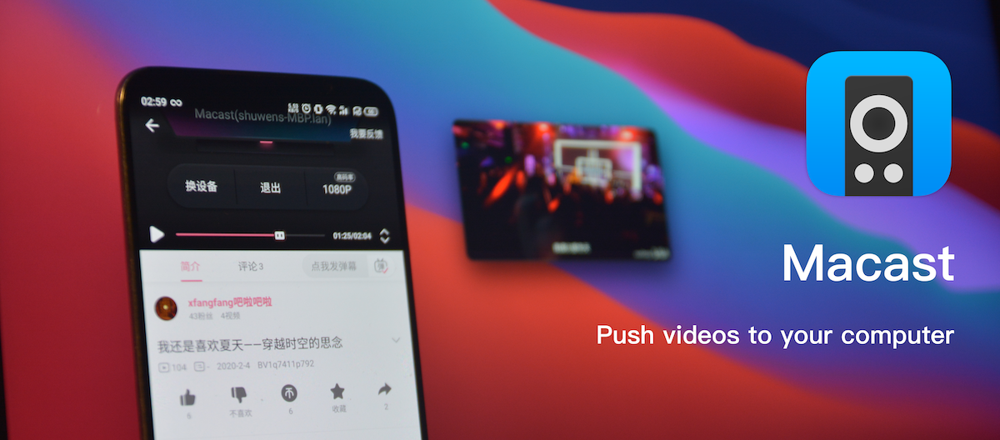

# Macast

[](https://github.com/xfangfang/Macast/releases/latest)

[](https://github.com/xfangfang/Macast/releases/latest)
[](https://github.com/xfangfang/Macast-plugins)
[](https://pypi.org/project/macast/)
[](https://aur.archlinux.org/packages/macast-git/)
[](https://github.com/xfangfang/Macast/actions/workflows/build-macast.yaml)
[](https://github.com/xfangfang/Macast/releases/latest)
[](https://github.com/xfangfang/Macast/releases/latest)
[](https://github.com/xfangfang/Macast/releases/latest)


[中文说明](README_ZH.md)

A menu bar application using mpv as **DLNA Media Renderer**. You can push videos, pictures or musics from your mobile phone to your computer.


## About this fork (Apple Silicon / arm64)

This is a fork of [xfangfang/Macast](https://github.com/xfangfang/Macast) that targets
**Apple Silicon natively** (arm64 only, no Rosetta, no universal2 binary), plus a set
of macOS playback fixes. Upstream is kept as `origin` and is still fetched normally.

Everything here is built and verified on macOS 15 / Apple M4 Pro.

### What changed

**Native arm64 support**
- Dependency fixes for arm64: `netifaces` (abandoned, no arm64 wheel) replaced with
  `psutil`, and the dead `lxml` dependency removed.
- mpv 0.41.0 for arm64 is bundled, with the MoltenVK ICD manifest published to the
  path the Vulkan loader actually looks in (`Contents/Resources/vulkan/icd.d`).
  Without it mpv falls back to software rendering and every frame fails with
  "Failed initializing any suitable GPU context".
- The app locates its bundled mpv relative to `sys.executable` instead of the working
  directory, which is wrong inside a PyInstaller bundle.
- `build-macos-arm64.sh` builds, signs and packages a verified `.app`/`.dmg`. It
  requires a fat binary: `PYTHON=/path/to/venv/bin/python3 ./build-macos-arm64.sh`.

**The player window was invisible on macOS 15** (three separate causes)
- `--ontop-level=system` put the window on `kCGDesktopWindowLevel` (CG layer 26),
  i.e. underneath the desktop icons and wallpaper. Removed; plain `--ontop` keeps it
  on the normal floating layer.
- `--geometry` was resolved against the whole virtual desktop, which on a machine
  with a stale display entry put the window off-screen at something like
  `(1763, -1596)`. Removed entirely -- mpv centres the window correctly on its own.
  Trade-off: the macOS "player position" setting no longer takes effect.
- mpv rewrites the size in a `--geometry=WxH+X+Y` with the video's own dimensions and
  recomputes the position from that, so even a correctly computed absolute pixel
  geometry came out wrong.

**Casting found the device but never played anything** (the real culprit)
- `set_media_url()` built `loadfile <url> replace start=0.0` without the `index`
  argument. mpv's signature is `loadfile <url> [flags] [index] [options]`, so it
  parsed the options string as the index and rejected the entire command:
  ```
  [ipc_0] The loadfile option must be an integer: start=0.0
  [ipc_0] Command loadfile: argument index can't be parsed
  ```
  `loadfile` replies `success` to a command it then refuses to run, and the DLNA
  layer reports `PLAYING` either way, so from the phone this looked like a renderer
  that was connected and ignoring the media. Now the index is passed explicitly.

**Silent failures are now reported**
- mpv's own output is captured into `macast_python.log` under the settings
  directory (`~/Library/Application Support/Macast/` on macOS). It used to go
  nowhere: `--no-terminal` suppressed everything and `proc.communicate()` only
  read the pipe after mpv exited. mpv writes to **stdout**, not stderr.
- After `loadfile`, playback is verified via `idle-active`. If the stream never
  opens -- an HTTP 403 from an expired signed CDN URL is routine for DLNA, since
  clients hand out time-limited links -- it is logged and the user gets a menu bar
  notification instead of silence.
- `SetAVTransportURI` fetches the renderer once and checks it, instead of looking it
  up three times and letting a `None` `AttributeError` disappear into CherryPy's
  handler while the client still gets a `200`.

**Build-time verification** -- three checks, of which the third is the only one that
would have caught the casting bug:
1. mpv can open a GPU context
2. the player window is on a visible CG layer and fully inside the primary screen
3. mpv actually plays a remote stream over IPC, using the exact argument list
   `set_media_url()` uses

Check 3 needs network access and skips instead of failing when offline.

### Building

```shell
python3 -m venv /tmp/macast_v
/tmp/macast_v/bin/pip install PyInstaller psutil lxml \
    pyobjc-core pyobjc-framework-Cocoa pyobjc-framework-Quartz
PYTHON=/tmp/macast_v/bin/python3 ./build-macos-arm64.sh
```


## Installation

- ### MacOS || Windows || Debian

  Download link:  [Macast release latest](https://github.com/xfangfang/Macast/releases/latest)

- ### Apple Silicon (this fork)

  Build it yourself with `./build-macos-arm64.sh` above -- there are no prebuilt
  arm64 releases here yet.

- ### Package manager

  ```shell
  pip install macast
  macast-gui # or macast-cli
  ```

  Please see our wiki for more information(like **aur** support): [#package-manager](https://github.com/xfangfang/Macast/wiki/Installation#package-manager)  
  Linux users may have problems installing using pip. Two additional libraries that I have modified need to be installed:

  ```shell
  pip install git+https://github.com/xfangfang/pystray.git
  pip install git+https://github.com/xfangfang/pyperclip.git
  ```

  **See [this](https://github.com/xfangfang/Macast/wiki/Installation#linux) for Linux compatibility**

- ### Build from source

  Please refer to: [Macast Development](docs/Development.md)


## Usage

- **For ordinary users**  
After opening this app, a small icon will appear in the **menubar** / **taskbar** / **desktop panel**, then you can push your media files from a local DLNA client to your computer.

- **For advanced users**  
  1. By loading the [Macast-plugins](https://github.com/xfangfang/Macast-plugins), Macast can support third-party players like IINA and PotPlayer.  
  For more information, see: [#how-to-use-third-party-player-plug-in](https://github.com/xfangfang/Macast/wiki/FAQ#how-to-use-third-party-player-plug-in)
  2. You can modify the shortcut keys or configuration of the default mpv player by yourself, see: [#how-to-set-personal-configurations-to-mpv](https://github.com/xfangfang/Macast/wiki/FAQ#how-to-set-personal-configurations-to-mpv)

- **For developer**  
You can use a few lines of code to add support for other players like IINA and PotPlayer or even add additional features, like downloading media files while playing videos.  
Tutorials and examples are shown in: [Macast/wiki/Custom-Renderer](https://github.com/xfangfang/Macast/wiki/Custom-Renderer).  
Fell free to submit a pull request to [Macast-plugins](https://github.com/xfangfang/Macast-plugins).  


## FAQ
If you have any questions about this application, please check: [Macast/wiki/FAQ](https://github.com/xfangfang/Macast/wiki/FAQ).  
If this does not solve your problem, please open a new issue to notify us, we are willing to help you solve the problem.

## Screenshots

You can copy the video link after the video is casted：  


Or select a third-party player plug-in  


## Relevant links

[UPnP™ Device Architecture 1.1](http://upnp.org/specs/arch/UPnP-arch-DeviceArchitecture-v1.1.pdf)

[UPnP™ Resources](http://upnp.org/resources/upnpresources.zip)

[UPnP™ ContentDirectory:1 service](http://upnp.org/specs/av/UPnP-av-ContentDirectory-v1-Service.pdf)

[UPnP™ MediaRenderer:1 device](http://upnp.org/specs/av/UPnP-av-MediaRenderer-v1-Device.pdf)

[UPnP™ AVTransport:1 service](http://upnp.org/specs/av/UPnP-av-AVTransport-v1-Service.pdf)

[UPnP™ RenderingControl:1 service](http://upnp.org/specs/av/UPnP-av-RenderingControl-v1-Service.pdf)

[python-upnp-ssdp-example](https://github.com/ZeWaren/python-upnp-ssdp-example)
